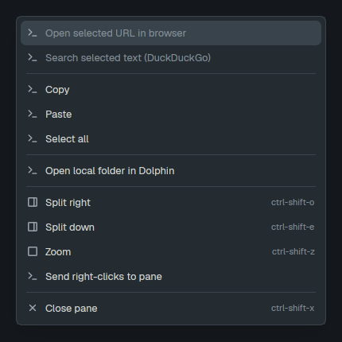

# Herdr QuickMenu

An expanded terminal right-click menu for Herdr Desktop, adapted from its shipped menu.



Experimental Linux/KDE mod. The preview is a crop of the real live menu with no text selected; disabled browser/search entries are intentional.

## Included actions

- Open a selected HTTP(S) URL in the default browser
- Search selected text with DuckDuckGo
- Copy, Paste, Select all
- Open a known local terminal folder in Dolphin
- Existing split, zoom, and close actions

## Requirements and limitations

This implementation targets Linux/KDE. URL/search extraction uses `qdbus6` and the running Klipper service; GUI launches use `kstart`, `xdg-open`, and `dolphin`. Herdr's `workspace-chrome` icon assets are referenced.

Copy operates on Herdr's terminal selection, not an application's internal selection. In mouse-capturing programs, hold Shift while dragging to create a terminal selection, then Shift-right-click for the menu. The user reported Copy works in a plain terminal but not with normal Hermes-owned highlighting; the Shift-selection workaround still needs interactive confirmation. Native loading checks do not prove clipboard delivery. URL opening was reported working interactively, while automated selection/clipboard tests were inconclusive.

Browser/search actions are explicit clicks; search sends the selected text to DuckDuckGo. HTTP(S) URLs with embedded credentials are rejected. Remote folders are not opened locally.

## Install

Read the destination's `~/.config/herdr-app/AGENTS.md` first. Back up an existing same-named mod before replacing it.

Copy `mods/selected-actions-menu/` into `~/.config/herdr-app/mods/`. The internal folder name is retained for compatibility with the installed implementation.

Add this top-level property to a personal layout (clone a shipped layout before editing):

```json
"terminal_menu": "selected-actions-menu"
```

Do not replace the whole destination layout. Check the installed mod:

```sh
herdr-app check "$HOME/.config/herdr-app/mods/selected-actions-menu"
```

Then test selection, Copy/Paste, URL opening, and local-folder opening interactively. To disable, remove the `terminal_menu` property to return to the built-in menu.

## Source

- `main.js`: menu UI and action dispatch
- `actions.js`: selection extraction, validation, and launch helpers
- `mod.json`: mod manifest
- `validation-tests.js`: URL, search, and local-folder validation tests
- `tests/run.py`: standalone runner using Herdr's actual JavaScript runtime

## Tests

From the repository root, with Python 3 and Herdr Desktop installed:

```sh
python3 tests/run.py
herdr-app check "$PWD/mods/selected-actions-menu"
```

The runner executes 32 validation tests in a temporary, undocked mod using Herdr's runtime. It deliberately emits a completion diagnostic because native checks suppress console output; only that exact diagnostic is accepted as success. Assertion failures fail the runner. It does not test clipboard delivery, browser launches, focus timing, or GUI interactions. See HERDR-DEV-CHECKLIST.md for the open interactive tests.

## Privacy and security

No analytics, background polling, or startup network request. Explicit browser/search actions run local programs and send selected data to the browser (DuckDuckGo for search). Selection extraction temporarily overwrites the system clipboard with a sentinel, then requests native Copy. The previous text is restored only on specific failure paths; non-text clipboard formats and clipboard history are not preserved. Do not use this workflow with sensitive clipboard contents. Concurrent clipboard writers can race the sentinel check; it cannot cryptographically establish which program wrote the replacement.

The default terminal-menu integration does not execute Git or contact remote machines. Inherited space-menu code can run read-only Git commands if another mod explicitly opens this as a space menu; that is not the advertised integration. No local configuration, editor declarations, diagnostic dumps, or installed icon files are distributed.

## License and provenance

Apache-2.0; see LICENSE and NOTICE. The UI derives from Herdr v0.1.16 at commit `034f8b85f7e6bb71f8ff55cb4a80c548b2578c0f`. The installed shipped menu was verified byte-identical to that upstream source. Modifications are marked in the derived files. Herdr's installed workspace-chrome icons remain external dependencies; their notices are retained for the rendered screenshot. This is an unofficial community mod.

Publication status and remaining acceptance checks are tracked in HERDR-DEV-CHECKLIST.md.
