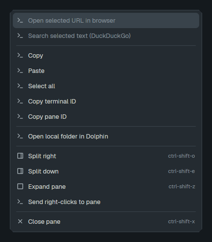

# Herdr QuickMenu

An expanded terminal right-click menu for people who want to open links, search selected text, copy and paste, and browse a local working folder without losing Herdr's pane controls.

The preview is a privacy-reviewed crop of the actual live menu in its no-selection state, not a mockup.

## What you see

A theme-following native popup, not a permanent panel. Group URL opening and DuckDuckGo search first; Copy, Paste, and Select all next; a local-folder action next; then the existing split, zoom, right-click-routing, parent-terminal, and close actions where applicable. Use a 390px-wide popup with a 425px height allowance, 5px outer padding, 31px rows, 12.8px labels, 14px shipped workspace-chrome icons, 7px row radii, subtle 1px separators, and keyboard navigation. Use theme popover, foreground, dim, muted, selected, hover and border colors. Invalid actions are disabled. Error notifications explain refused operations.

## How it behaves

The menu belongs to the terminal that was right-clicked, not whichever terminal later happens to be active. Keep the clicked pane and terminal identifiers and distinguish model panes from layout blocks when the popup opens. Preserve Up/Down, Enter, and Escape behavior. Recheck the chosen action and its arguments, not its old row number, before dispatch.

Open selected URL accepts one complete HTTP(S) URL and launches the local default browser. Reject credentials in the authority, unsupported schemes, whitespace, control characters, and malformed URLs. Search explicitly sends the selected text, URI-encoded, to DuckDuckGo; reject empty or excessively long input.

Copy queues popup closure, focus of the clicked terminal, then native terminal.copy. Paste and Select all act on that terminal. Never simulate Ctrl+C, since it may interrupt a running program. Terminal-owned selections and application-owned highlights differ: in mouse-capturing applications, instruct the user to try Shift-drag and Shift-right-click, without claiming that internal application selection is accessible.

Open local folder in Dolphin uses the clicked terminal's current directory only after confirming local machine ownership and a local absolute path. Never treat remote paths as local, and never substitute the initial space directory for an unknown current directory.

## Built from

Keep `mods/selected-actions-menu/` with `main.js`, `actions.js`, and `mod.json`. `validation-tests.js` contains validation helpers; `tests/run.py` executes them in the native runtime. The internal identifier remains selected-actions-menu; Herdr QuickMenu is the project name.

Start from Herdr's shipped menu, preserving its applicable original actions and required attribution. Use native gpui-kit/gpui-base builders, Herdr props, terminals, panes, spaces, focus, command dispatch, overlays, notifications, and exec APIs. Reuse installed workspace-chrome icons; no HTML or browser view.

Set manifest placement to none. In an existing personal layout, merge the top-level property `"terminal_menu": "selected-actions-menu"`. Clone a shipped layout first if necessary, but distribute no layouts directory and do not replace the user's whole layout. No keybinding changes are required.

This version's selection-text helper uses KDE Klipper via qdbus6: verify a sentinel, request a fresh native copy, and reject failure rather than using stale clipboard data. It attempts to restore prior clipboard text when the sentinel remains. GUI launches use literal arguments through kstart with xdg-open or Dolphin. Do not interpolate selected text into shell scripts. No network access or background polling is needed on startup; browser/search actions run only on user request.

## Watch out

- Target Linux/KDE with Klipper, qdbus6, kstart, xdg-open, and Dolphin. Do not advertise macOS, Windows, or generic Linux compatibility without adapting and testing these dependencies.
- Read the installed AGENTS.md and API declarations. API compatibility and the presence of referenced icons must be checked on the destination.
- Render success, mocked dispatch, and a native mod check do not establish clipboard success. Background probes have failed while the user reported interactive URL opening worked.
- Copy was reported working in a plain terminal, but not with normal Hermes-owned highlighting. Shift-selection remains an interactive acceptance test, not a proven fix.
- Terminal focus, popup lifetime, mouse capture, and selection ownership must be investigated separately. Do not repeatedly change timing based only on synthetic background tests.
- Upstream menu licensing was verified against Herdr v0.1.16, commit `034f8b85f7e6bb71f8ff55cb4a80c548b2578c0f`: Apache-2.0. Retain LICENSE, NOTICE, and modified-file notices.
- Clipboard extraction changes the clipboard and can leave a sentinel or selected text behind on failure; clipboard history and non-text formats are not restored. A concurrent clipboard writer can race the sentinel check. Do not describe it as a guaranteed source-authentication mechanism.

## Done when

- Native `herdr-app check` passes for the exact packaged code.
- In a foreground terminal, a known selected marker copies exactly; Paste and Select all work on the intended terminal.
- URL and search actions are exercised interactively; unsafe schemes, credentials, absent selections, and stale targets are rejected.
- Local folder opening works and remote/unknown folders are refused.
- Existing split, zoom, and close actions remain usable; installing the menu does not alter layout styling, other mods, or global keys.
- Mouse-capturing application behavior and any remaining limitations are documented honestly.
- A privacy-reviewed preview.png and license notices are present. Distinguish executed tests from outstanding interactive acceptance checks in the gallery checklist.
